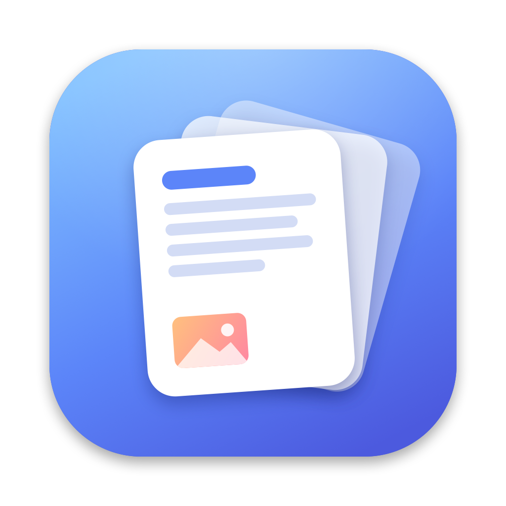
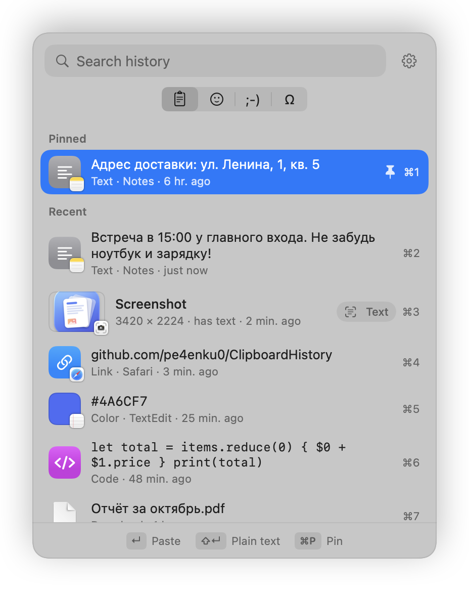
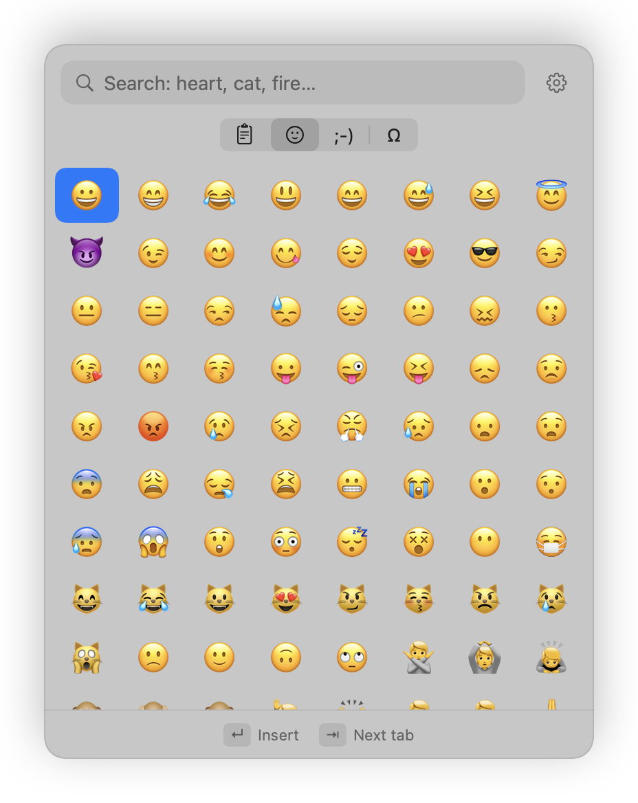
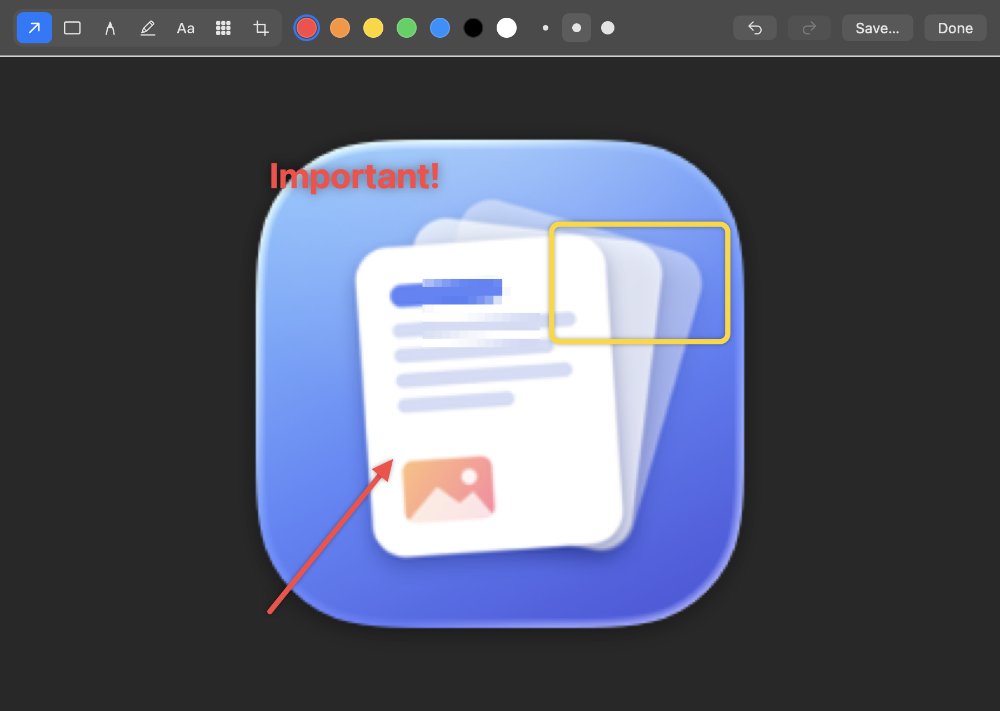

<p align="center"></p>

<h1 align="center">ClipboardHistory</h1>

<p align="center">Clipboard history, emoji and a screenshot editor for macOS, one shortcut away.<br>Like <kbd>Win</kbd>+<kbd>V</kbd> on Windows, but for the Mac.</p>

<p align="center">
  
  
</p>

## Features

- **History of everything you copy.** Text, links, code, colors, images and files, with formatting kept. Press <kbd>⌥</kbd><kbd>V</kbd> (configurable) and the panel opens right at your text cursor.
- **Paste without leaving the keyboard.** <kbd>↩</kbd> pastes, <kbd>⇧</kbd><kbd>↩</kbd> pastes as plain text, <kbd>⌘</kbd><kbd>1</kbd>…<kbd>9</kbd> pick an item, <kbd>⌘</kbd><kbd>P</kbd> pins it. Pinned items are never removed.
- **Search, even inside pictures.** Text in screenshots and copied images is recognized on device (English and Russian), so you can find a screenshot by what's in it, or paste its text.
- **Emoji, kaomoji and symbols.** Typed straight into the app you're in, without filling up your history.
- **Screenshots go straight to the clipboard.** New screenshots, screen recordings and downloads are ready for <kbd>⌘</kbd><kbd>V</kbd> as soon as they're saved.
- **Screenshot editor.** Arrows, boxes, pen, highlighter, text, crop, and blur to hide private info. You can also use the built-in macOS Markup instead.
- **English and Russian**, light and dark mode, and a Liquid Glass style on macOS 26.

<p align="center"></p>

## Privacy

Everything stays on your Mac. The app makes no network requests.

- History is stored **encrypted** (AES-GCM) in `~/Library/Application Support/ClipboardHistory/`. The key is kept in your login keychain.
- Passwords copied from password managers (1Password, KeePassXC and others that mark them as concealed) are never saved.
- API keys, access tokens, JWTs and private keys are recognized and never saved.
- Add any app to **Ignore these apps** and nothing copied from it is saved. You can also pause the history from the menu bar.
- Old items can be removed automatically after a number of days.

## Install

Requires macOS 14 or later, on Apple Silicon or Intel.

1. Download `ClipboardHistory-macos.zip` from the [latest release](../../releases/latest) and unzip it.
2. Move **ClipboardHistory.app** to your Applications folder.
3. Open it. The app isn't notarized by Apple, so macOS will block it the first time. Go to **System Settings → Privacy & Security**, scroll down and click **Open Anyway**.
4. Follow the short setup. To have items pasted right into your text, allow **Accessibility** access when asked. Without it, items are only copied.

The first time the app saves its history, macOS asks to let it use its key in your keychain. Click **Always Allow**.

### Build from source

Needs the Xcode Command Line Tools (`xcode-select --install`).

```bash
git clone https://github.com/pe4enku0/ClipboardHistory.git
cd ClipboardHistory
./build.sh               # builds and installs into ~/Applications
./build.sh --no-install  # only builds build/ClipboardHistory.app
```

### Uninstall

Quit the app from the menu bar, then delete `ClipboardHistory.app` and `~/Library/Application Support/ClipboardHistory`. Optionally remove the `io.github.pe4enku0.ClipboardHistory` item from Keychain Access.

## По-русски

История буфера обмена для macOS, как <kbd>Win</kbd>+<kbd>V</kbd> в Windows. По <kbd>⌥</kbd><kbd>V</kbd> открывается панель с тем, что вы копировали: текст, картинки и файлы. Ещё в ней есть эмодзи, каомодзи и символы. Работает поиск, в том числе по тексту на скриншотах. Есть редактор скриншотов с размытием для скрытия личных данных. История хранится только на вашем Mac в зашифрованном виде. Пароли из менеджеров паролей, ключи API и токены не сохраняются. Интерфейс на русском и английском. Как установить, описано выше в разделе **Install**.

## License

[MIT](LICENSE)
